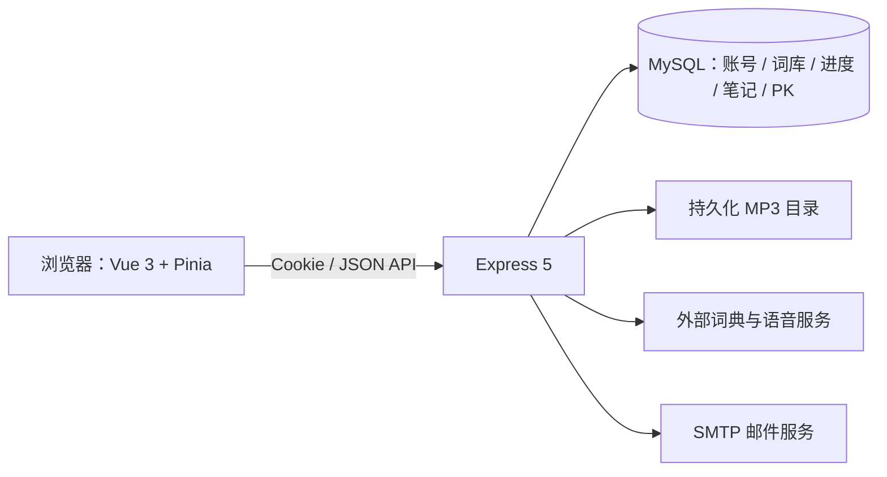

# 单词口袋 · WordHop

单词口袋（WordHop）是一个支持个人词库、听写、默写、选择题、拼词游戏和限时 PK 的 Web 应用。它使用 Vue 3、Express 和 MySQL，适合个人、家庭或小型学习小组自行部署。

本文对应仓库中的当前实现。项目不需要 OpenAI API Key，也不依赖大模型服务。
线上使用 地址：http://www.syrkitty.com:5173/ 账号：xiaoming 密码：12345678 截图：


欢迎大家邮箱自行注册使用，欢迎留言 174389642@qq.com ！
## 功能一览

| 模块 | 可以做什么 |
| --- | --- |
| 单词学习 | 按单元记忆、听写、根据中文默写、选择题、拼词打怪 |
| 学习进度 | 每个账号、每个词库分别保存进度、错题、上次单元及全对次数 |
| 系统词库 | 小学、初中、高中、研究生、雅思、六级、四级，共七类 |
| 个人词库 | 从系统库查询、通过网络词典查询、手工添加，支持修改和删除 |
| 发音管理 | 新增单词时下载 MP3，复用已有本地文件；管理员可试听、上传或通过 URL 导入 |
| 我的笔记本 | 每人独立的笔记，包含标题、富文本内容、创建日期，支持分页和增删改查 |
| 限时 PK | 随机抽取 20–100 个单词，依次完成选择、听写和默写，按用时排名 |
| PK 重试 | 有效期内可重新参加；重置本次计时及此前成绩；首页每页 3 条 |
| 社区与激励 | 留言板、积分榜、学习时长宠物及积分兑换 |
| 账号管理 | 邮箱注册验证、登录、修改密码、邮件找回密码、管理员启用或禁用账号 |
| 管理后台 | 用户管理、单词管理、发音补全、操作日志；管理员可在首页删除 PK |
| 游客体验 | 浏览系统词库并学习，学习状态只保留在本次访问中 |

注册需要 SMTP 邮件服务；使用初始化的管理员账号和游客模式，不需要先完成普通用户注册。

## 技术架构



- 前端：Vue 3、Vite、Pinia、Axios，使用 JavaScript。
- 后端：Node.js、Express 5、mysql2、Zod、bcryptjs、sanitize-html。
- 认证：MySQL 中保存 Session，浏览器使用 HttpOnly Cookie。
- 构建：Vite 输出到 `server/public`，生产环境可以由 Express 同时提供页面、API 和音频。
- 页面切换由 Vue 中的状态控制，没有引入 Vue Router。

## 环境要求

- Node.js 22 系列或更高的兼容版本；本项目部署已使用 Node.js 22.13.1。
- 建议使用 pnpm 11；公开版本以 pnpm 11 验证安装和构建。已有服务器的生产依赖安装曾使用 pnpm 10.15.1。
- MySQL 8，数据库字符集使用 `utf8mb4`，存储引擎使用 InnoDB。
- Windows、Linux 或 macOS；服务器进程需要能够连接 MySQL，并写入音频目录。
- 使用网络查词、下载发音或发送邮件时，需要相应出站网络访问。

## 从零安装

以下命令都从项目根目录执行。将示例中的用户名、仓库地址、密码和域名改成自己的值。

### 1. 获取代码与安装依赖

从 GitHub 或 Gitee 选择一个地址：

```bash
git clone https://github.com/whjybear/wordhop.git
# 或 git clone https://gitee.com/whjybear/wordhop.git
cd wordhop
pnpm install --frozen-lockfile
```

公开仓库：[GitHub](https://github.com/whjybear/wordhop) · [Gitee](https://gitee.com/whjybear/wordhop)。两个平台均使用维护者账号 `whjybear`。

### 2. 创建数据库

使用有创建数据库权限的账号进入 MySQL：

```bash
mysql -u root -p
```

执行以下 SQL，自行替换密码：

```sql
CREATE DATABASE wordhop CHARACTER SET utf8mb4 COLLATE utf8mb4_unicode_ci;
CREATE USER 'wordhop'@'localhost' IDENTIFIED BY 'REPLACE_WITH_YOUR_DATABASE_PASSWORD';
GRANT ALL PRIVILEGES ON wordhop.* TO 'wordhop'@'localhost';
```

这是应用自有数据库的权限，包含初始化及升级时的建表、修改表权限。如果数据库与应用不在同一台机器，应为应用实际来源主机配置对应账号，并修改连接地址；不要直接照用 `localhost`。

### 3. 配置环境变量

Linux / macOS：

```bash
cp .env.example .env
```

PowerShell：

```powershell
Copy-Item .env.example .env
```

编辑根目录 `.env`，至少填写：

```dotenv
MYSQL_HOST=127.0.0.1
MYSQL_PORT=3306
MYSQL_DATABASE=wordhop
MYSQL_USER=wordhop
MYSQL_PASSWORD=REPLACE_WITH_YOUR_DATABASE_PASSWORD
SESSION_SECRET=REPLACE_WITH_A_RANDOM_SECRET_AT_LEAST_32_CHARACTERS
PORT=3001
WEB_ORIGIN=http://localhost:5173
APP_BASE_URL=http://localhost:5173
COOKIE_SECURE=false
ADMIN_USERNAME=admin
ADMIN_PASSWORD=REPLACE_WITH_A_STRONG_PASSWORD
ADMIN_NAME=管理员
ADMIN_PHONE=13800000000
ADMIN_EMAIL=admin@example.com
```

生成随机会话密钥：

```bash
node -e "console.log(require('node:crypto').randomBytes(32).toString('hex'))"
```

管理员邮箱应替换为你自己的邮箱。`.env` 不应提交到仓库。

### 4. 初始化表、系统词库和管理员

推荐直接执行：

```bash
pnpm db:init
```

脚本会创建完整表结构、导入根目录的七个词库文件、创建配置的管理员，以及用户个人词库。管理员初始为已验证、可登录状态。

也提供纯 SQL 初始化文件 `database/init.sql`。在已创建并选中的空数据库中，可以先导入：

```sql
USE wordhop;
SOURCE database/init.sql;
```

`SOURCE` 的路径相对于启动 MySQL 客户端时的工作目录。SQL 包含 15 张表和七类词库定义，不包含真实用户、密码、学习记录、单词正文或音频。之后仍应运行 `pnpm db:init` 导入词库文本并用 `.env` 创建管理员；一般无需同时采用两种初始化方式。

`pnpm db:init` 是首次安装工具。再次运行会按文本覆盖已有系统词条的音标、释义和来源，并用 `.env` 中的管理员密码更新对应管理员，不应当作日常启动命令。

### 5. 启动开发环境

```bash
pnpm dev
```

打开 `http://localhost:5173`。前端开发端口为 5173，后端端口为 3001；Vite 已代理 `/api` 和 `/audio` 到后端。

如果修改后端端口，需要同时修改 `frontend/vite.config.js` 的代理目标。

## 如何使用

### 普通学习

1. 使用初始化管理员登录，或选择游客体验。
2. 在首页选择词库和每单元的词数（10、20、30 或 50）。
3. 选择记忆、听写、默写、选择或游戏模式。
4. 已登录用户的答题记录、错题和进度会保存；游客刷新或离开后不保证保留。
5. 在错题本中复习；首页可查看每单元的全对次数。

听写默认重复播放发音；没有音频地址或播放失败时显示中文释义，方便继续答题。第一次播放可能需要用户点击，以满足浏览器的自动播放限制。

### 注册、验证和密码

配置 SMTP 后，可通过注册页面创建账号。验证邮件链接有效期为 24 小时；成功验证后账号变为可用状态。管理员也能管理账号状态，但未验证邮箱的账号不能直接审核通过。

找回密码和管理员重置密码目前采用“把新密码发送到邮箱”的方式，用户登录后应立即修改密码。未配置 SMTP 时，相应操作不可用。

### 个人词库与笔记

- 点击首页“管理我的词库”，从系统库或网络词典查询，也可以手工填写词条。
- 点击“我的笔记本”，新增带标题的笔记，使用加粗、斜体、下划线、标题、列表等格式；列表每页 10 条。
- 笔记内容会在服务器进行 HTML 清理；粘贴采用纯文本，不支持任意 HTML、图片和附件。
- 个人词库、笔记属于当前账号，其他普通用户不能读取或修改。

### 限时 PK

选择词库、开始及结束时间，以及 20–100 个单词后创建挑战。系统保存随机抽取的题目，所有参与者使用同一组题目。

挑战依次进行选择、听写和默写，每题有 30 秒倒计时。挑战有效期内，无论上一次是否完成，均可重新开始；重新开始会覆盖此前计时和成绩，排名保留当前已完成的这一条记录，不保留历史多次成绩。挑战结束后不能重新开始或计入新的完成成绩。

首页每页展示 3 条；已结束超过一天的挑战不再出现在首页列表。管理员可以直接删除挑战及关联成绩。

### 管理后台

管理员在首页打开“管理后台”，可管理用户、搜索和维护单词、查看行为日志。单词的发音栏可展示文件地址并试听；缺失时可上传 MP3，或输入 HTTP/HTTPS 音频地址，由服务器下载保存到本地。

目前手工上传和地址导入仅接受通过 MP3 校验的文件，最大 10MB；不是通用音频转码功能。

## 发音文件与外部服务

单词内容、音频文件及音频关联是三份不同的数据：`words` 保存单词与 `audio_url`，MP3 文件保存在磁盘；迁移或备份时必须同时处理数据库和音频目录。

- 新增个人词条或管理员新增词条时，会尝试下载发音；已有有效的同名单词 MP3 则直接复用。
- 普通词条文件名按小写单词生成；管理员上传会保存为独立的 `custom-UUID.mp3`。
- 网络查词优先使用有道接口，失败时尝试 Dictionary API；后者可能只返回英文解释。
- 自动发音下载尝试有道和百度语音接口。这些外部服务的可用性及返回内容不由本项目保证。
- 仓库初始化不会为七个词库逐词下载全部音频，也不会包含线上私有音频库。

生产环境应设置绝对、持久化的音频目录，例如：

```dotenv
AUDIO_WORDS_DIR=/var/lib/wordhop/audio/words
```

安装者需创建该目录并赋予应用运行账号写权限。若已有合法来源的 MP3 词库，将文件放入目录后可执行：

```bash
pnpm --dir server audio:sync
```

该命令会清除指向缺失本地文件的关联，并关联同名 MP3；有效的现有关联会保留。它只扫描本地文件，不负责从网络批量下载，当前批量扫描主要按文件大小判断，仍应试听确认内容。

## 生产部署

### 单进程方式

在项目根目录构建：

```bash
pnpm build
```

修改 `.env`，使访问地址与实际部署一致。例如先在 HTTP 的 3001 端口验证：

```dotenv
NODE_ENV=production
PORT=3001
WEB_ORIGIN=http://YOUR_SERVER:3001
APP_BASE_URL=http://YOUR_SERVER:3001
COOKIE_SECURE=false
AUDIO_WORDS_DIR=/var/lib/wordhop/audio/words
```

然后启动：

```bash
pnpm start
```

访问 `http://YOUR_SERVER:3001`。生产环境由 Express 提供打包后的静态资源，不需要额外运行 Vite。`SESSION_SECRET` 至少为 32 个字符，否则生产模式拒绝启动。

### Linux 常驻服务示例

假定项目位于 `/opt/wordhop`，运行账号是已创建的 `wordhop`，Node 位于 `/usr/bin/node`。请按实际安装路径调整：

```ini
# /etc/systemd/system/wordhop.service
[Unit]
Description=WordHop
After=network.target

[Service]
Type=simple
User=wordhop
WorkingDirectory=/opt/wordhop
ExecStart=/usr/bin/node /opt/wordhop/server/src/index.js
Restart=on-failure
RestartSec=5
Environment=NODE_ENV=production

[Install]
WantedBy=multi-user.target
```

应用自行读取项目根目录 `.env`；该文件需对应用运行账号可读，对其他无关账号不可读。音频目录需可写。

```bash
sudo systemctl daemon-reload
sudo systemctl enable --now wordhop
sudo systemctl status wordhop
journalctl -u wordhop -n 100
```

### 使用域名与 HTTPS

可以在 Nginx 等反向代理上终止 TLS，并转发至 `127.0.0.1:3001`。以下是代理部分的参考配置，需要加入你自己的域名、证书和 443 监听配置：

```nginx
location / {
    proxy_pass http://127.0.0.1:3001;
    proxy_set_header Host $host;
    proxy_set_header X-Forwarded-Host $host;
    proxy_set_header X-Forwarded-Proto $scheme;
    proxy_set_header X-Forwarded-For $proxy_add_x_forwarded_for;
    client_max_body_size 11m;
    proxy_read_timeout 60s;
}
```

相应配置：

```dotenv
WEB_ORIGIN=https://words.example.com
APP_BASE_URL=https://words.example.com
COOKIE_SECURE=true
```

应用已设置 `trust proxy=1`，适合单层可信代理。若部署了多层代理，应结合实际网络重新审视此配置。防火墙应将后台端口限定为可信来源，避免不可信客户端绕过代理伪造转发头。

原维护者的服务器运维工具依赖私有配置，未包含在公开版本中；自建部署使用本节的通用流程，无需原站点的任何凭据。

## 配置参数

| 参数 | 说明 |
| --- | --- |
| `MYSQL_HOST / MYSQL_PORT` | MySQL 地址及端口，端口默认 3306 |
| `MYSQL_DATABASE / MYSQL_USER / MYSQL_PASSWORD` | 数据库名、应用账号及密码 |
| `SESSION_SECRET` | Session 签名密钥，生产环境至少 32 字符 |
| `PORT` | Express 端口，默认 3001 |
| `WEB_ORIGIN` | 允许的浏览器来源，包含协议和非标准端口，无末尾斜杠 |
| `APP_BASE_URL` | 邮件验证链接使用的公网地址 |
| `COOKIE_SECURE` | HTTPS 设为 `true`，HTTP 调试设为 `false` |
| `NODE_ENV` | 生产环境设为 `production` |
| `AUDIO_WORDS_DIR` | 音频绝对路径；未设时相对于启动进程当前工作目录 |
| `ADMIN_USERNAME / ADMIN_PASSWORD` | 仅初始化管理员时使用；修改环境变量不会立即改变数据库中的密码 |
| `ADMIN_NAME / ADMIN_PHONE / ADMIN_EMAIL` | 初始化管理员资料 |
| `SMTP_HOST / SMTP_PORT / SMTP_SECURE` | SMTP 主机、端口、是否使用隐式 TLS；默认端口 465、`true` |
| `SMTP_USER / SMTP_PASSWORD` | SMTP 登录账号及授权码或密码 |
| `SMTP_FROM_NAME / SMTP_FROM_EMAIL` | 邮件发件人名称和地址 |

本项目不自动推断邮箱供应商参数；请按自己的 SMTP 服务填写。保留 SMTP 必填项为空即可让程序识别为未配置邮件服务。

## 升级、检查与备份

更新前备份数据库、音频目录和 `.env`，然后在新版本目录中执行：

```bash
pnpm install --frozen-lockfile
pnpm --dir server schema:sync
pnpm build
pnpm --dir server test
```

最后重启自己的服务。`schema:sync` 用于兼容已有安装的增量结构；它不等同于完整的版本化迁移或数据回滚系统，也不会导入全部词库。

```bash
curl -f http://127.0.0.1:3001/api/health
```

正常返回 `{"status":"ok"}`，此接口会实际查询数据库。检查范围还应包括登录、词库读取、笔记保存以及音频播放；后端的自动化测试使用数据库桩，不代替完整真实环境测试。

常规 MySQL 备份可以使用客户端工具：

```bash
mysqldump -h 127.0.0.1 -u wordhop -p --single-transaction --no-tablespaces wordhop > wordhop-backup.sql
```

备份文件不得放入公开仓库。恢复时先选择目标数据库导入 SQL，再恢复音频到同一个配置目录，并检查文件权限。还应保留 `.env`，特别是数据库连接和会话配置；这些均是私有资料。

## 常见问题

| 问题 | 排查方法 |
| --- | --- |
| MySQL `Access denied` | 数据库已启动不代表凭据正确；检查用户、密码、来源主机授权及 `.env` |
| 外键创建失败 | 使用当前完整 SQL 从空库初始化；确认 InnoDB、表结构及 MySQL 版本 |
| 管理员无法登录 | 确认执行了 `pnpm db:init`，管理员密码不是默认占位符，邮箱已写入初始化记录 |
| 注册或找回密码失败 | 检查 SMTP 必填项、授权码、出站端口和发件人配置 |
| 邮件链接无法访问 | 检查 `APP_BASE_URL`；本地地址只能在运行站点的电脑上打开 |
| 登录后马上失效 | 检查 HTTP 下是否错误设置 `COOKIE_SECURE=true`，以及代理、Cookie 和来源地址 |
| 浏览器提示来源无效 | 核对 `WEB_ORIGIN`、公网协议、端口及转发头 |
| 有单词但没有声音 | 检查 `audio_url`、MP3 是否存在、目录权限、网络下载结果及浏览器播放限制；管理员可补传 |
| 开发环境音频 404 | 确认后端在 3001 运行，以及 Vite `/audio` 代理和音频目录设置 |
| 修改了源码但页面不变 | 重新 `pnpm build`，确认运行的是新版本，再刷新浏览器缓存 |
| 初始化缺少词库文件 | 保持七个根目录文本的原文件名和 UTF-8 编码；不要只复制 `server` 目录做首次安装 |

## 项目结构

```text
frontend/                   Vue 界面、状态及样式
  src/App.vue               页面和学习交互
  src/stores/learning.js    词库、学习状态与持久化调用
  public/icons/             Twemoji 图标及来源说明
server/
  src/index.js              API、权限、Session、音频与静态站点
  src/db.js                 MySQL 连接池及根目录环境配置
  src/schema.sql            完整建表定义
  src/init-db.js            首次初始化和词库导入
  src/sync-schema.js        现有安装的结构兼容更新
  src/sync-libraries.js     四类学段词库更新
  src/sync-audio.js         本地音频关联同步
  tests/features.test.js    关键接口逻辑测试
  public/                   前端构建产物，重新生成即可
database/init.sql           可手工导入的完整结构和七类词库定义
*.txt                       七个系统词库源文件，见初始化脚本清单
.env.example                无真实凭据的配置模板
```

`libraries:sync` 当前只更新小学、初中、高中和研究生四类词库，不会更新雅思、六级和四级。词库文本采用每行 `word,phonetic,meaning` 的形式：解析器用前两个英文逗号分列，其余部分保留为释义。

## 参与改进与素材说明

反馈问题时请说明操作步骤、运行环境和已去除凭据的错误日志；不要上传 `.env`、真实用户数据库、邮箱、会话、私人笔记或私有部署文件。

当前实现更适合个人或小群体使用。PK 排名和积分部分依赖客户端提交的完成事件，不宜直接用作有奖竞赛或严格考核。项目尚未内置多实例任务调度、完整迁移回滚和通用文件附件系统。

界面图标采用 Twemoji，来源和 CC-BY 4.0 署名信息位于 `frontend/public/icons/README.txt`。词库文本、语音和词典返回内容的来源及使用条件应分别确认；本仓库不包含原服务器的个人数据和私有音频库。项目原创代码按 [MIT License](LICENSE) 授权。第三方依赖、Twemoji 图标、词库数据及外部服务内容保留各自的授权条件，不因代码采用 MIT 而变更，详见 [第三方素材说明](THIRD_PARTY_NOTICES.md)。

构建依赖配置见 `pnpm-workspace.yaml`：按 [pnpm 构建脚本设置](https://github.com/pnpm/pnpm/blob/main/pnpm/docs/settings/build.md) 明确允许 esbuild 的安装脚本，其他依赖不会因此获得通用脚本执行许可。
